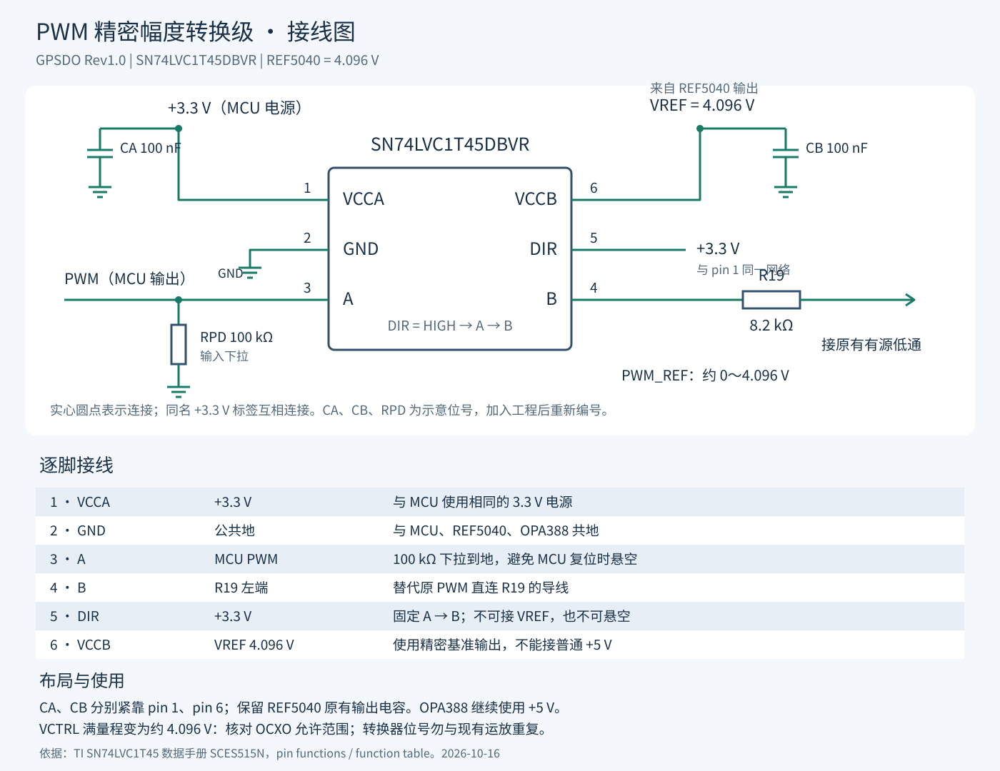

# PWM 精密幅度转换级接线说明

器件：SN74LVC1T45DBVR，DBV / SOT-23-6。此图按用户截图的原理图符号排列绘制，不是 PCB 封装俯视图。引脚号是接线依据。

| 引脚 | 名称 | 连接 |
| --- | --- | --- |
| 1 | VCCA | MCU +3.3 V；就近加 100 nF 到 GND |
| 2 | GND | 公共 GND |
| 3 | A | MCU PWM；加 100 kΩ 下拉到 GND |
| 4 | B | R19 8.2 kΩ 的原 PWM 输入端 |
| 5 | DIR | +3.3 V，与 pin 1 同网，固定 A→B |
| 6 | VCCB | REF5040 输出 VREF 4.096 V；就近加 100 nF 到 GND |

## 按截图操作

1. 原 PWM 标签接至 pin 3（A），不要接 pin 1 或 pin 2。
2. pin 4（B）接 R19 左端，删除原 PWM 绕过转换器直接接 R19 的连接。
3. pin 1 和 pin 5 分别放 +3.3 V 标签，二者属于同一网络。
4. pin 6 放 VREF 标签，确认与 REF5040 输出端的标签完全一致。
5. pin 2 接 GND；补两颗 100 nF 去耦和一颗 100 kΩ 输入下拉。
6. 为转换器分配未使用的 U 位号。截图中标为 U10，若运放仍叫 U10，应消除重复编号。图中 CA、CB、RPD 均为临时示意位号。

## 后级与布局

- OPA388 仍用 +5 V 供电，原有 Sallen–Key 连接、R17 和 C19 保持。
- CA 紧靠 pin 1，CB 紧靠 pin 6，接地回路短。保留 REF5040 原有输出电容；两个电源之间不互相短接。
- VREF 去耦与供电走线应短，避免 PWM 输出长线贴近 VCTRL 与运放输入。完成后测 VREF 在 PWM 切换时的扰动。
- 这一级不反相。理想近似 VCTRL = D × 4.096 V，D 为 0～1 占空比；实际存在输出压降、边沿误差及后级误差，需要实测校准。
- 核对实际 OCXO 的调谐端允许电压和所需调谐范围，固件相应设置占空比限值。上电未初始化时输入下拉会趋向低电平控制；若需要启动在中点，需由固件及时设置约 50% 占空比。

## 资料依据

[TI SN74LVC1T45 数据手册（SCES515N）](https://www.ti.com/lit/ds/symlink/sn74lvc1t45.pdf)，第 2 页引脚表、第 14 页功能表。两侧供电范围均为 1.65～5.5 V，DIR 高时 A→B。

本文件为接线指导，未更改 KiCad 原理图。
